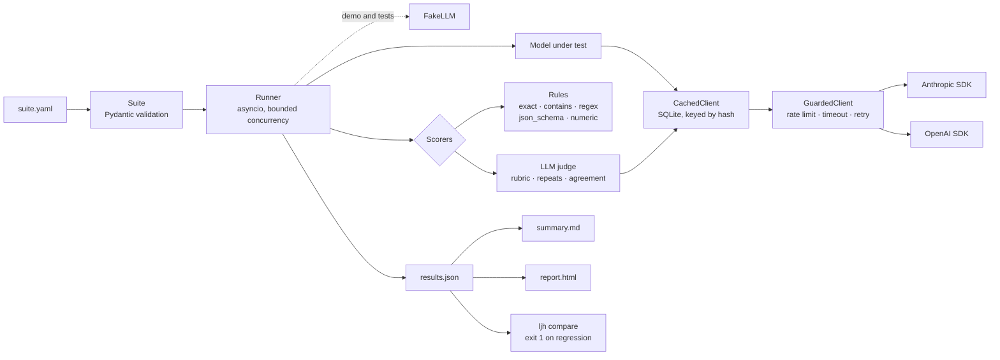

# llm-judge-harness

Run a test suite of prompts across LLMs, score the answers with rules and an LLM judge, and get a pass-rate report.
One YAML file in; a `results.json`, a Markdown summary, a single-file HTML report and a CI-ready `compare` gate out.

## Why it's interesting

- **Two kinds of scoring, one result shape.** Cheap deterministic rules (`exact`, `contains`, `regex`, `json_schema`, `numeric`) sit next to an `llm_judge` with a weighted rubric. Every scorer returns the same `ScoreResult`, so reports and diffs never care which kind ran.
- **The judge is treated as a measuring instrument that can be noisy.** It can be asked N times; verdicts are aggregated by mean or majority, and the report shows an agreement stat and score spread, so you can see when the judge itself is unsure.
- **Structured output you can trust.** Judge replies are validated with Pydantic (scores 1-5, exactly the rubric's criteria). One repair turn is allowed; after that the run counts as failed with a clear error instead of crashing the whole suite.
- **Production habits on a small codebase.** Client-side rate limiter, per-call timeout, retries with exponential backoff + full jitter (honouring `Retry-After`), an SQLite response cache so re-runs are free, token and cost tracking, and fail-fast on bad keys or model names.
- **Gates CI.** `ljh compare base/ candidate/` lists regressions and improvements per case and exits 1 when a case that passed now fails, or a case went missing.

## Architecture



## Quickstart (no API key needed)

Requires Python 3.12 and [uv](https://docs.astral.sh/uv/).

```bash
make install   # uv sync into .venv
make demo      # both example suites against fake models, then a compare
open runs/demo/json-extraction/report.html
```

The demo uses `fake:` models: `fake:echo` repeats the prompt, `fake:strong` and `fake:weak` answer from canned replies in `examples/fake/answers.yaml` (with deliberate mistakes), and `fake:judge` is a deterministic word-overlap stand-in for a real judge. Abridged output:

```
| Model       | Pass rate | Passed | Mean score | ... |
| fake:strong | 100.0%    | 5/5    | 0.96       | ... |
| fake:weak   | 40.0%     | 2/5    | 0.79       | ... |

## Worst cases
| fake:weak | signature-block | 0.46 | json_schema: output is not valid JSON (Expecting value) | ...
| fake:weak | two-people      | 0.76 | llm_judge: 0/3 runs reached 0.75 (majority needed); agreement 100% | ...

Judge: 30 call(s) (0 cached) · tokens 9,693/2,304 · est. cost $0.0000 · mean agreement on repeated cases: 93.3%

## Regressions (1)
| fake:strong | capital-australia | 1.00 | 0.00 |
(compare exited 1: a regression was found, so a CI job would fail here)
```

A case's score is the mean of its scorers, which is why `two-people` scores 0.76 yet fails: the schema passed, the judge did not.

### With real models

```bash
cp .env.example .env   # add your keys, then: set -a && source .env && set +a

# Bare "anthropic" / "openai" use LJH_ANTHROPIC_MODEL / LJH_OPENAI_MODEL.
uv run ljh run examples/factual_qa.yaml -m anthropic -m openai -m fake:echo
uv run ljh run examples/json_extraction.yaml -m anthropic:claude-sonnet-5-5 --judge anthropic

# Run it again: every response comes from the SQLite cache, so it costs nothing.
uv run ljh report runs/<suite>-<run id>            # re-render summary.md + report.html
uv run ljh compare runs/<baseline> runs/<candidate>  # exit 1 on a regression or missing case
```

`ljh run --help` lists every option (`--out`, `--concurrency`, `--no-cache`, `--quiet`, `--fake-answers`).

## Suite format

```yaml
name: factual-qa
system_prompt: Answer the question in one short sentence.
max_tokens: 1024            # optional, else LJH_MAX_TOKENS
default_scorers:            # used by cases without their own `scorers`
  - type: contains          # defaults to the case reference
cases:
  - id: water-boiling-point
    input: At sea level, what is the boiling point of water in degrees Celsius?
    reference: 100
    tags: [science, numeric]
    scorers:                # replaces the defaults for this case
      - type: numeric
        tolerance: 0.5
  - id: contact
    input: "Thanks! Priya Raman, Bluefin Analytics, priya@bluefin.example.com"
    reference: '{"name": "Priya Raman", "company": "Bluefin Analytics", ...}'
    scorers:
      - type: json_schema
        schema: { type: object, required: [name, email] }
      - type: llm_judge
        repeats: 3
        aggregate: majority # or mean
        rubric:
          pass_threshold: 0.75
          criteria:
            - { name: field_accuracy, weight: 2, description: Fields match the reference. }
            - { name: no_hallucination, weight: 2, description: Nothing is invented. }
```

| Scorer | Passes when | Options |
|---|---|---|
| `exact` | output equals `expected` (default: reference); runs of whitespace count as one space, case ignored unless `case_sensitive` | `case_sensitive` |
| `contains` | output contains `values` (default: reference); partial credit | `match: all\|any`, `case_sensitive` |
| `regex` | `re.search(pattern)` matches | `ignore_case` |
| `json_schema` | output (code fences stripped) is JSON valid against `schema` | |
| `numeric` | first number in the output (not glued to a word, so `GPT-4` reads as 4) is within `tolerance` of `expected` (default: reference) | `tolerance` |
| `llm_judge` | weighted rubric score (each criterion 1-5, normalised to 0-1) reaches `pass_threshold` | `repeats`, `aggregate` |

A case passes when all its scorers pass; its score is the mean of their scores. Missing references, bad regexes, invalid JSON Schemas and remote `$ref`s are caught when the suite loads, not mid-run.

## Configuration

All settings come from environment variables (see `.env.example`).

| Variable | Default | What it does |
|---|---|---|
| `ANTHROPIC_API_KEY` | - | Anthropic key (an `ant auth login` profile also works) |
| `OPENAI_API_KEY` | - | OpenAI key |
| `LJH_ANTHROPIC_MODEL` | `claude-sonnet-5-5` | Model for a bare `-m anthropic` |
| `LJH_OPENAI_MODEL` | `gpt-6.1-sol` | Model for a bare `-m openai` |
| `LJH_JUDGE_MODEL` | `anthropic:claude-sonnet-5-5` | Judge when `--judge` is not given |
| `LJH_TIMEOUT_S` | `60` | Timeout per provider call, in seconds |
| `LJH_MAX_RETRIES` | `4` | Retries on 408/429/5xx, network errors and timeouts (waits capped at 60 s, `Retry-After` included) |
| `LJH_MAX_CONCURRENCY` | `8` | Cases in flight, and calls in flight per provider |
| `LJH_RPM` | `60` | Client-side requests-per-minute cap per provider |
| `LJH_MAX_TOKENS` | `16000` | Default `max_tokens` (thinking/reasoning tokens count towards it) |
| `LJH_CACHE_PATH` | `.ljh_cache.sqlite` | SQLite response cache |
| `LJH_PRICES_FILE` | - | YAML of `provider:model: {input, output}` USD per 1M tokens, merged over the built-in table in `src/ljh/pricing.py` |

## Testing

```bash
make lint   # ruff check + ruff format --check
make test   # pytest with coverage (gate: 95%; currently 100% lines and branches)
```

No test touches the network. Providers are tested through the real Anthropic and OpenAI SDKs over an in-process `httpx2.MockTransport`, so request bodies, response parsing and error mapping (429 with `Retry-After`, 5xx, 401, connection errors) are exercised for real. Everything else uses `FakeLLM`.

## Design decisions & tradeoffs

- **One small protocol, wrapped in layers.** Every model is an `LLMClient` with one method, `complete(request) -> response`. Reliability is added by wrapping, in this order: `CachedClient(GuardedClient(provider))`. Cache hits never wait on the rate limiter, and failed calls are never cached. Fake models skip both layers.
- **The harness owns retries; the SDKs' are switched off** (`max_retries=0`). With two retry layers a single 429 could become 3 x 5 = 15 calls. One layer means one place that applies backoff with full jitter and respects `Retry-After`.
- **Errors are sorted by blast radius.** Missing credentials fail before the first call. A bad key or unknown model (401/403/404) would fail every case the same way, so the run aborts with one clear message. A 400 or exhausted retries becomes a failed row for that case. A judge repeat that returns bad JSON twice is counted as a failed run; the remaining repeats still decide, and the score only fails if every repeat failed. One flaky call never sinks a 500-case run.
- **Judge design.** Small integer scales (1-5) per criterion are easier for a model to apply consistently than free floats; weights and the threshold live in the suite, not the prompt. Each repeat carries a `sample` index in the cache key, so repeats are real fresh calls on the first run and free on re-runs. Agreement is the share of runs that match the majority verdict, so it reads the same under `mean` and `majority`.
- **No `temperature`.** Current Anthropic models reject sampling parameters, so judge variance is real and measured (agreement, stdev) rather than hidden behind temperature 0.
- **Refusals are scored, not rescued.** A refusal comes back as `stop_reason: refusal` and is recorded. A server-side fallback to another model was left out on purpose: it would quietly replace the model under test.
- **Self-contained HTML.** Jinja2 with autoescaping on, because model output is untrusted text. No external CSS, JS or fonts. Each case is its own `<tbody>`, so sorting moves a row together with its drill-down.
- **SQLite calls run inline on the event loop.** A local lookup takes microseconds next to API calls that take seconds, so a thread pool or an async driver would add code without speeding anything up.
- **`compare` defines a regression as pass to fail on the same (model, case).** A score that drops but still passes is not a regression, which keeps the CI gate quiet when nothing broke. A case missing from the candidate run also fails the gate, because it can no longer be checked.
- **Costs say "n/a" rather than guess.** A model without a price entry shows `n/a`, not `$0`, and the "spent this run" total includes judge calls and leaves out cache hits.

## Limitations & roadmap

- `fake:judge` is a word-overlap heuristic for demos and tests, not a real judge.
- Single-turn cases only: no multi-turn conversations, tools or images.
- No mitigation for judge bias (for example a model judging itself). Pairwise A/B judging with order swapping would help.
- The answer is placed in the judge prompt as-is, so an answer that imitates the prompt's tags could try to steer its own grade.
- Every reply is cached, including a judge reply that failed validation, so re-running replays that failure until you pass `--no-cache`.
- Prices are a hand-kept table (checked November 2026). Cache hits count as free.
- `compare` reports raw pass-rate changes. Bootstrap confidence intervals would show whether a change is noise.
- Roadmap: Message Batches for cheaper judge runs, a per-scorer judge model override, and agreement with human labels (Cohen's kappa).
